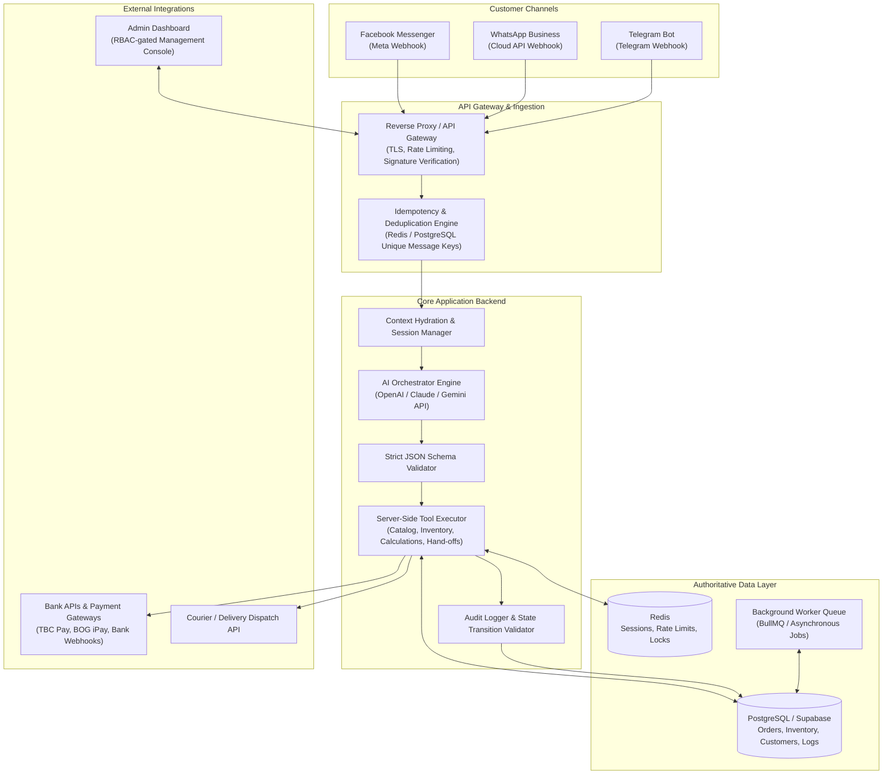
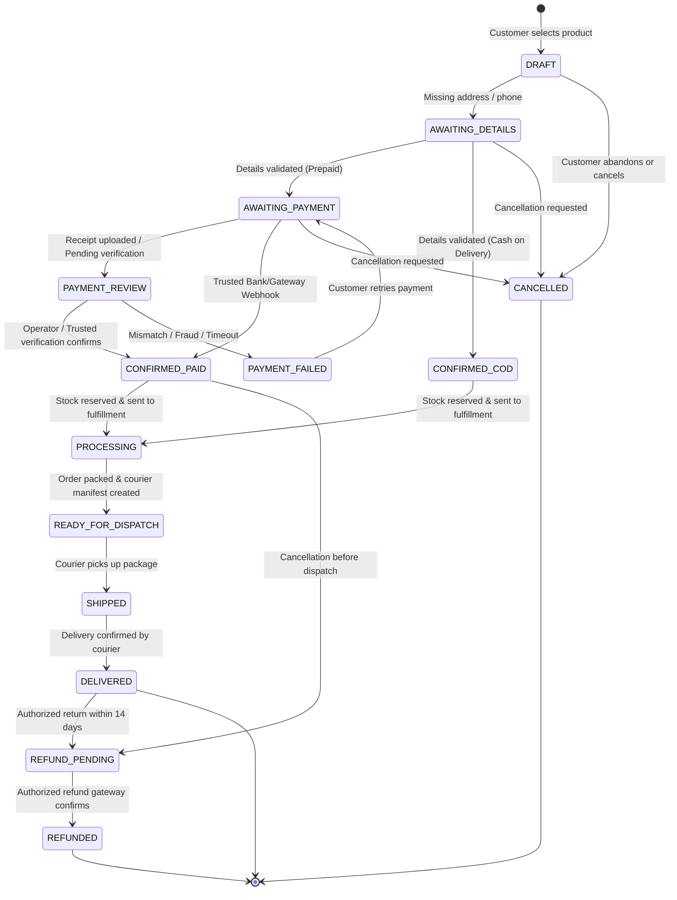
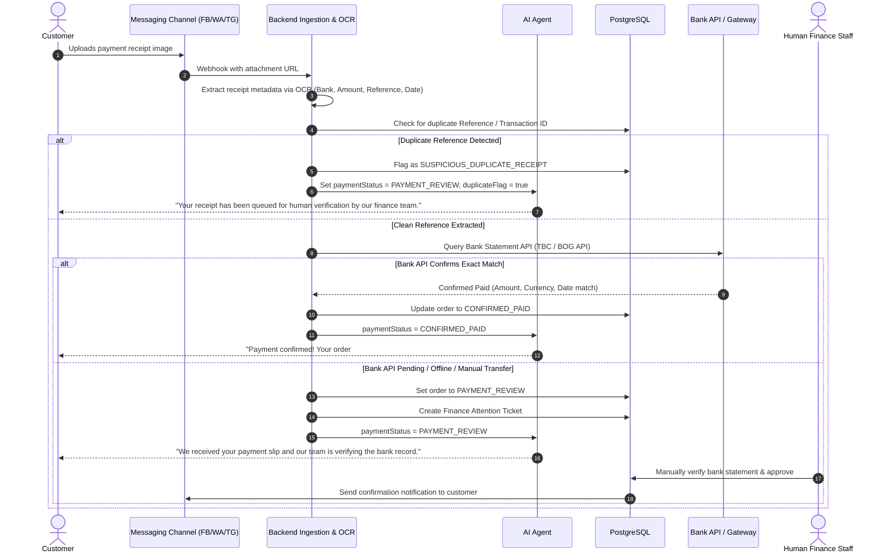

# SYSTEM ARCHITECTURE & INTEGRATION SPECIFICATION
**Omnichannel AI Sales & Customer Support Platform**
*Architecture Blueprint | Version 3.0*

---

## 1. Executive Architectural Overview

The Omnichannel AI Sales & Customer Support Platform connects multiple customer messaging touchpoints (**Facebook Messenger, WhatsApp Business Platform, and Telegram**) to a single, high-availability, secure, and transactional backend service.

The architecture is built on the principle that **the AI model is an orchestrator, not the source of truth**. All business rules, prices, inventory levels, order state transitions, and payment validations are enforced strictly by backend server code and relational database constraints.



---

## 2. Component Breakdown

### 2.1 Edge & Ingestion Layer
- **Webhook Verifiers**: Each platform's cryptographic signature is verified before processing:
  - Meta/Messenger: `X-Hub-Signature-256` HMAC-SHA256 signature checked against `MESSENGER_APP_SECRET`.
  - WhatsApp: `X-Hub-Signature-256` HMAC-SHA256 signature checked against `WHATSAPP_APP_SECRET`.
  - Telegram: `X-Telegram-Bot-Api-Secret-Token` checked against `TELEGRAM_WEBHOOK_SECRET`.
- **Deduplication Engine**: Uses an atomic check-and-set pattern on `idempotency_keys` (or Redis `SETNX`) using `(platform, platform_message_id)`. If an incoming webhook was already received within the deduplication window (e.g. 24 hours), it is acknowledged with HTTP 200 immediately without re-triggering AI or database writes.

### 2.2 Core Application Server
- **Context Hydration**: Fetches the active conversation thread (`conversations`), recent messages (last 10-15 turns), customer record (`customers`), and any active uncompleted order (`orders` with status `DRAFT`, `AWAITING_DETAILS`, `AWAITING_PAYMENT`).
- **AI Orchestration**: Passes the hydrated conversation, authoritative business configurations, and available tool definitions to the LLM. The LLM returns a single structured JSON response.
- **Strict Schema Validation**: Validates the LLM JSON output against the Zod/JSON schema. If parsing fails, the output is routed through a fallback sanitizer or escalated safely without exposing raw errors to the user.
- **Server-Side Tool Executor**: Executes required backend actions:
  - `LOOKUP_PRODUCT`: Queries the PostgreSQL `products` and `product_variants` tables.
  - `CHECK_STOCK`: Performs real-time inventory queries.
  - `CALCULATE_ORDER_TOTAL`: Authoritative server calculation of subtotal, delivery fee, discounts, and tax.
  - `VALIDATE_PHONE` & `VALIDATE_ADDRESS`: Normalizes and validates phone numbers (e.g. Georgian `+995 5XX...`) and addresses.
  - `CREATE_ORDER`: Transactionally commits the order and creates inventory reservations.
  - `VERIFY_PAYMENT`: Checks trusted payment gateway records or queues transaction for human review.
  - `REQUEST_HUMAN_HANDOFF`: Creates an escalated support ticket (`handoff_tickets`).

### 2.3 Authoritative Data Layer (PostgreSQL)
- Relational schema enforcing referential integrity, check constraints on status enums, and optimistic/pessimistic locking (`SELECT ... FOR UPDATE`) to prevent inventory overselling.
- Complete audit logging (`audit_logs`) tracking every status change, actor ID, and tool execution.

---

## 3. Order Lifecycle State Machine

An order must strictly follow allowed state transitions. The AI model or an API caller cannot force invalid jumps (e.g., an order cannot transition from `DRAFT` directly to `SHIPPED`).



### Allowed Transition Rules Matrix
| Current Status | Allowed Next Statuses | Actor / Trigger |
|---|---|---|
| `DRAFT` | `AWAITING_DETAILS`, `CANCELLED` | AI Agent, Customer |
| `AWAITING_DETAILS` | `AWAITING_PAYMENT`, `CONFIRMED_COD`, `CANCELLED` | AI Agent, Backend Validator |
| `AWAITING_PAYMENT` | `PAYMENT_REVIEW`, `CONFIRMED_PAID`, `CANCELLED` | Bank Webhook, Receipt Analysis, Customer |
| `PAYMENT_REVIEW` | `CONFIRMED_PAID`, `PAYMENT_FAILED` | Authorized Finance Staff, Gateway Webhook |
| `CONFIRMED_COD` | `PROCESSING`, `CANCELLED` | Automated Order Manager, Staff |
| `CONFIRMED_PAID` | `PROCESSING`, `REFUND_PENDING` | Automated Order Manager, Staff |
| `PROCESSING` | `READY_FOR_DISPATCH`, `CANCELLED` (with refund) | Warehouse Staff |
| `READY_FOR_DISPATCH`| `SHIPPED`, `CANCELLED` | Warehouse Staff, Courier Webhook |
| `SHIPPED` | `DELIVERED`, `CANCELLED` (Returned to sender) | Courier Integration Webhook |
| `DELIVERED` | `REFUND_PENDING` (Authorized Return) | Support Agent, Return Workflow |
| `REFUND_PENDING` | `REFUNDED` | Finance Staff, Payment Gateway |

---

## 4. Payment Verification & Fraud Prevention Architecture

> [!CRITICAL]
> **Receipts, OCR, and customer claims are untrusted inputs.** An image of a bank receipt or a mobile banking screenshot can easily be faked, edited, or reused.



---

## 5. Multi-Channel Identity Isolation

1. **Platform Identity vs Customer Identity**:
   - Every incoming message has a platform-specific ID:
     - Facebook Messenger: `sender.id` (Page-scoped ID, PSID).
     - WhatsApp: Phone number (`from`, e.g. `995599123456`).
     - Telegram: `from.id` (Numeric Telegram User ID).
   - These are stored in `channel_identities`.
2. **Strict Isolation Rule**:
   - A customer is **never automatically merged** across channels solely by matching a first name, last name, or unverified platform ID.
   - An account link between a Telegram user and a WhatsApp user requires either:
     - Verified phone number OTP (One-Time Password) confirmation.
     - Authenticated customer login link.
     - Explicit staff verification in the Admin Dashboard with customer consent.

---

## 6. Concurrency & Race Condition Prevention

When multiple customers order the last remaining inventory item simultaneously:
1. `inventory_reservations` uses PostgreSQL transactional locking:
   ```sql
   BEGIN;
   SELECT stock_quantity, reserved_quantity 
   FROM product_variants 
   WHERE id = $variant_id 
   FOR UPDATE;

   -- Check if available stock > 0
   -- If yes, INSERT into inventory_reservations with a 15-minute expiration
   -- UPDATE product_variants SET reserved_quantity = reserved_quantity + $qty
   COMMIT;
   ```
2. If the reservation expires before order confirmation or payment, a background worker (`cron` / `BullMQ`) releases the reservation back to available stock.

---

## 7. Reliability, Retries & Dead Letter Queues (DLQ)

- **External Platform Outages**: If Meta Graph API, WhatsApp Cloud API, or Telegram Bot API returns 5xx or times out, outgoing messages are pushed to a Redis-backed queue (`messages_outbound_queue`) with exponential backoff (1s, 2s, 5s, 15s, 60s).
- **Dead Letter Queue (DLQ)**: After 5 failed attempts, the message moves to `dlq_messages` and triggers an alert in the Admin Dashboard (`Attention Needed -> Failed Integration Event`).
- **No False Positives**: The AI agent never states "I have notified an operator" or "Your order is confirmed" unless the database transaction has committed and the external API response returns HTTP 200/201.
