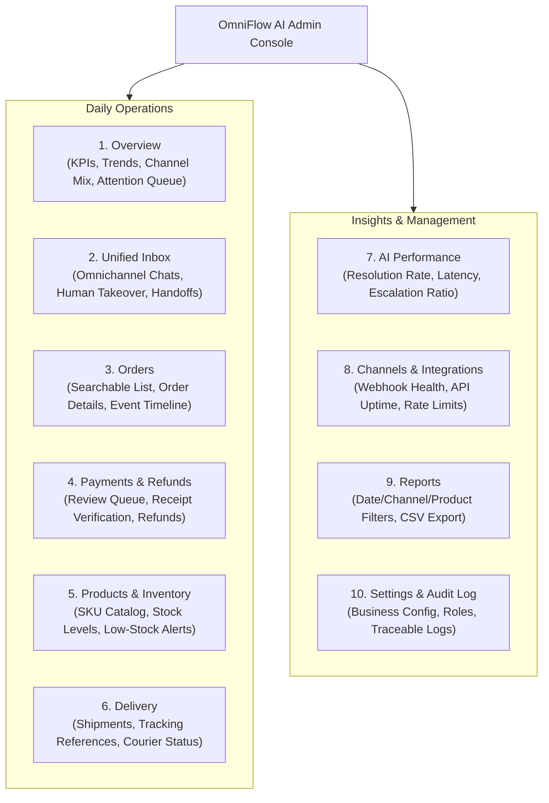

# ADMIN DASHBOARD SPECIFICATION & ARCHITECTURE
**Omnichannel AI Sales & Customer Support Platform**
*Administrative Workspace Manual | Version 3.0*

---

## 1. Purpose and Operating Principles

The Admin Dashboard provides authorized business staff with a single, unified operational cockpit for the AI sales and customer-support system across **Facebook Messenger, WhatsApp Business, and Telegram**.

### 1.1 Fundamental Principles
1. **Administrative Interface, Not Source of Truth**:
   The dashboard never invents or calculates business metrics locally. All prices, stock quantities, payments, order states, and customer permissions must be retrieved from the backend API.
2. **Explicit Data Freshness & Mock Indicator**:
   Any demo or cached data must be prominently marked with a banner. In production, every view must display `lastUpdatedAt` and a manual refresh trigger.
3. **Server-Enforced Role-Based Access Control (RBAC)**:
   Users see and interact only with endpoints authorized for their assigned role (Admin, Manager, Support, Finance, Warehouse, Analyst).
4. **Non-Color Status Indicators & Accessibility**:
   Status badges must include text labels and visual iconography (not color alone), meeting WCAG 2.1 AA accessibility standards.
5. **Two-Step Confirmation for Consequential Actions**:
   Destructive or financial actions (cancelling an order, issuing a refund, manually confirming payment, reassigning agents) require an explicit confirmation modal with an explanation reason.

---

## 2. Main Navigation Structure (10 Core Views)

---

## 3. View Specifications

### 3.1 Overview View
- **Top KPI Cards**:
  1. *Total Conversations*: Count, % delta vs previous period.
  2. *Orders Created*: Backend-validated orders count.
  3. *Confirmed Sales*: Authoritative monetary sum in GEL (`₾`). Excludes cancelled/refunded orders.
  4. *Needs Attention*: Aggregated queue count (Payment Reviews + Human Handoffs + Low Stock).
- **Interactive Visualizations**:
  - *Sales & Conversation Trend Line Chart*: Daily dual-axis curve.
  - *Channel Distribution*: Volume and percentage split (Messenger vs WhatsApp vs Telegram).
  - *Attention Queue*: Direct quick-action items with timestamp and one-click drilldown.

### 3.2 Unified Inbox View
- **Omnichannel Feed**: Incoming messages unified across FB, WhatsApp, Telegram with channel badges.
- **Identity Clarity**: Shows `Channel Identity` (e.g. `@dato_k`, Telegram ID `123456`) separate from `Verified Customer` (`Dato Kikalishvili`, Phone `+995 599 *** *12`).
- **Human Takeover Workflow**:
  - Staff clicks *"Take over conversation"*.
  - AI is paused for that thread (`is_human_assigned = true`).
  - Input composer opens for human agent.
  - When resolved, staff clicks *"Return to AI"* with optional closing notes.

### 3.3 Orders View
- **Search & Filter**: Filter by Order ID, Customer name, Phone, Channel, Date, and Order Status (`DRAFT`, `AWAITING_PAYMENT`, `CONFIRMED_PAID`, `PROCESSING`, `SHIPPED`, `DELIVERED`, `CANCELLED`).
- **Order Detail Drawer**:
  - Itemized SKU breakdown with quantities and unit prices.
  - Server-calculated subtotal, delivery fee, discounts, and total.
  - Delivery details with optional PII reveal button (audit-logged).
  - Event Timeline: Visual log from initial draft to courier delivery.

### 3.4 Payments & Refunds View
- **Payment Review Queue**:
  - Lists orders awaiting manual bank verification (e.g. wire transfer via TBC or Bank of Georgia).
  - Side-by-side view: Expected order amount vs Uploaded customer receipt OCR vs Bank API event.
  - Verification actions: `Approve (Mark Paid)` or `Reject / Request Resubmission`.
- **Refund Management**:
  - Requires mandatory reason code, manager approval, and records audit trail.

### 3.5 Products & Inventory View
- List of master products and active variants.
- Real-time stock counts: `Physical Stock`, `Reserved in Checkout`, and `Available to Sell`.
- Low-stock badge triggered when stock drops below threshold.

### 3.6 Delivery & Fulfillment View
- List of packages awaiting courier pickup and currently in transit.
- One-click manifest creation for courier dispatch.
- External tracking status integration (`In Transit`, `Out for Delivery`, `Delivered`).

### 3.7 AI Performance & Quality Assurance View
- Operational metrics:
  - Median First-Response Latency (Target: < 2.5s).
  - Human Escalation Rate (% of total conversations escalated).
  - Resolution Rate (% of conversations resolved without human intervention).
  - Fallback / Error Rate (% of schema retries or tool failures).
- Quality Sampling: Audit table of randomly sampled conversations for supervisor review.

### 3.8 Channels & Integrations View
- Real-time health indicators for:
  - Meta Messenger Webhook (Last event time, HTTP 200 rate).
  - WhatsApp Cloud API Webhook (Message delivery receipts).
  - Telegram Bot API (Webhook status, pending updates count).
  - Database & Redis connectivity.

### 3.9 Reports View
- Customizable date ranges (Today, 7D, 30D, Custom).
- Breakdown by channel and top-selling products.
- Secure CSV Export with spreadsheet formula injection protection.

### 3.10 Settings & Audit Log View
- Immutable table of all system events and operator actions.
- Displays Actor ID, Role, Action, Entity, Timestamp, and Correlation ID.
- Searchable by Order ID or User ID.

---

## 4. UI Component Architecture & States

Each view must support 5 essential states:
1. **Loading State**: Subtle skeleton placeholders (not disruptive full-screen spinners).
2. **Empty State**: Clear informational message with an actionable next step.
3. **Data State**: High-contrast, scannable data tables with keyboard focus navigation.
4. **Stale Data Warning**: Yellow banner if WebSocket/polling fails to refresh within 60s.
5. **Permission Denied State**: Clean banner explaining role restrictions without disclosing backend internal paths.
