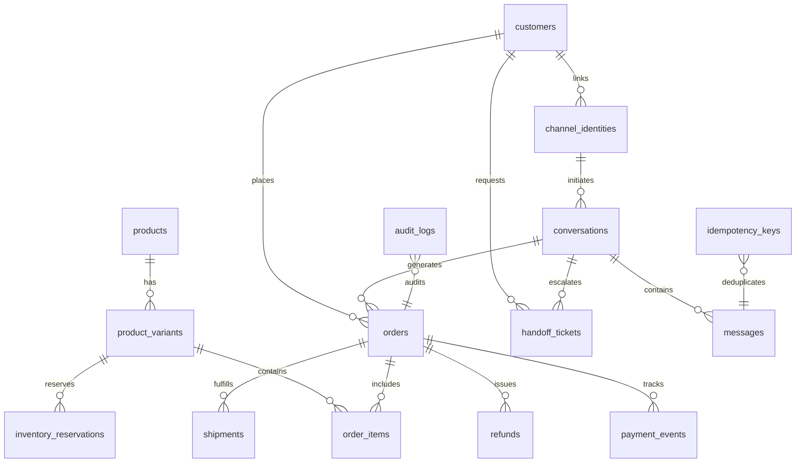

# DATABASE ARCHITECTURE & SCHEMA REFERENCE
**Omnichannel AI Sales & Customer Support Platform**
*Database Specification | Version 3.0*

---

## 1. Entity-Relationship (ER) Diagram

---

## 2. Table-by-Table Data Dictionary

### 2.1 Products & Catalog

#### `products`
The core catalog item definition.
- `id` (UUID, Primary Key): Unique internal product identifier.
- `sku` (VARCHAR, Unique): Master SKU identifier.
- `name` (VARCHAR): Product name in English / Primary.
- `name_ka` (VARCHAR): Product name in Georgian.
- `description` / `description_ka` (TEXT): Product specifications and details.
- `category` (VARCHAR): Catalog grouping (e.g. `Smartphones`, `Audio`).
- `base_price` (DECIMAL): Authoritative base price in GEL.
- `is_active` (BOOLEAN): Soft delete flag. If `false`, hidden from AI queries.
- `warranty_info` (TEXT): Official warranty terms (e.g. `12 Months Official Brand Warranty`).

#### `product_variants`
Specific purchasable options (color, size, storage capacity).
- `id` (UUID, Primary Key): Unique variant identifier.
- `product_id` (UUID, FK -> `products.id`): Parent product reference.
- `variant_sku` (VARCHAR, Unique): Specific SKU (e.g. `IPHONE-15-256-BLK`).
- `name` (VARCHAR): Human-readable variant descriptor.
- `stock_quantity` (INTEGER): Total physical inventory units in warehouse.
- `reserved_quantity` (INTEGER): Units temporarily held in pending checkouts.
- `low_stock_threshold` (INTEGER): Trigger level for dashboard inventory alerts (default 5).
- `is_available` (BOOLEAN): Availability flag computed or manually overridden.

#### `inventory_reservations`
Temporary stock holds preventing race conditions and overselling during checkout.
- `id` (UUID, Primary Key): Reservation record ID.
- `variant_id` (UUID, FK -> `product_variants.id`): Variant being held.
- `quantity` (INTEGER): Number of reserved items.
- `order_id` (UUID, Nullable): Bound order reference.
- `session_id` (VARCHAR): Webhook/session identifier.
- `expires_at` (TIMESTAMPTZ): Reservation expiration timestamp (standard: 15 minutes).
- `is_released` (BOOLEAN): Set to `true` when order is cancelled or reservation expires.

---

### 2.2 Customer & Omnichannel Identity

#### `customers`
The verified real-world customer entity.
- `id` (UUID, Primary Key): Customer master ID.
- `full_name` (VARCHAR): Customer's real name.
- `phone` (VARCHAR): Normalized E.164 phone number (e.g. `+995599123456`).
- `email` (VARCHAR): Verified or customer-provided email address.
- `city` (VARCHAR): Default delivery city.
- `delivery_address` (TEXT): Default street address and apartment number.
- `is_verified` (BOOLEAN): True when phone/identity has passed OTP or staff check.

#### `channel_identities`
Stores platform-specific identifiers, keeping platform data strictly isolated.
- `id` (UUID, Primary Key): Channel identity record ID.
- `customer_id` (UUID, Nullable, FK -> `customers.id`): Linked customer (set only when verified).
- `channel` (ENUM: `messenger`, `whatsapp`, `telegram`): Messaging platform.
- `platform_user_id` (VARCHAR): Platform-scoped user ID (PSID for Messenger, phone for WhatsApp, user ID for Telegram).
- `platform_username` (VARCHAR): Telegram `@username` or platform screen name.
- `display_name` (VARCHAR): Name provided by platform profile API.
- `is_confirmed_link` (BOOLEAN): Explicitly true only after verified linking.

---

### 2.3 Conversations & Messages

#### `conversations`
Represents an ongoing interaction thread.
- `id` (UUID, Primary Key): Conversation ID.
- `channel_identity_id` (UUID, FK -> `channel_identities.id`): Originating identity.
- `channel` (ENUM): Fast-lookup platform indicator.
- `is_human_assigned` (BOOLEAN): True when conversation is handed off to human staff.
- `assigned_to_user_id` (UUID): Staff member assigned to case.
- `current_intent` (VARCHAR): Last classified intent (`order`, `complaint`, etc.).
- `is_closed` (BOOLEAN): Thread status.

#### `messages`
Individual message turns.
- `id` (UUID, Primary Key): Message ID.
- `conversation_id` (UUID, FK -> `conversations.id`): Parent thread.
- `platform_message_id` (VARCHAR): Platform's original message ID (for deduplication).
- `sender_type` (ENUM: `customer`, `ai_agent`, `human_agent`, `system`).
- `content` (TEXT): Plaintext message body.
- `attachments` (JSONB): Metadata for images, audio, or receipts with OCR data.
- `is_read` (BOOLEAN): Read receipts.

---

### 2.4 Orders & Financials

#### `orders`
The single authoritative transactional record of a customer purchase.
- `id` (UUID, Primary Key): Internal order UUID.
- `order_number` (VARCHAR, Unique): Human-friendly order number (e.g. `#ORD-1048`).
- `customer_id` (UUID, FK -> `customers.id`): Purchasing customer.
- `channel` (ENUM): Channel where the order was placed.
- `status` (ENUM): Current order state (see State Machine).
- `payment_status` (ENUM): Payment status (`UNVERIFIED`, `CONFIRMED_PAID`, etc.).
- `payment_method` (ENUM): Selected payment gateway/method.
- `subtotal` (DECIMAL): Server-calculated item sum in GEL.
- `delivery_fee` (DECIMAL): Authoritative delivery charge.
- `discount_amount` (DECIMAL): Server-validated promo code reduction.
- `total_amount` (DECIMAL): Final total = `subtotal + delivery_fee + tax - discount`.
- `confirmed_by_customer_at` (TIMESTAMPTZ): Explicit customer consent timestamp.

#### `order_items`
Individual line items in an order.
- `id` (UUID, Primary Key): Line item ID.
- `order_id` (UUID, FK -> `orders.id`): Parent order.
- `variant_id` (UUID, FK -> `product_variants.id`): Purchased SKU.
- `quantity` (INTEGER): Quantity ordered.
- `unit_price` (DECIMAL): Price locked at time of order creation.
- `total_price` (DECIMAL): `unit_price * quantity`.

---

### 2.5 Payments, Refunds & Shipments

#### `payment_events`
Tracks all payment attempts, webhooks, bank transfers, and manual reviews.
- `id` (UUID, Primary Key): Event ID.
- `order_id` (UUID, FK -> `orders.id`): Target order.
- `provider` (VARCHAR): Gateway or bank identifier (`TBC_IBAN`, `BOG_IBAN`, `TBC_PAY`, `BOG_IPAY`).
- `provider_transaction_id` (VARCHAR, Unique per provider): Bank reference number.
- `amount` (DECIMAL): Amount recorded in bank event.
- `is_verified_by_provider` (BOOLEAN): True if confirmed by signed provider webhook or API.
- `verified_by_user_id` (UUID): Finance reviewer ID if manually approved.

#### `refunds`
Audited record of financial reversals.
- `id` (UUID, Primary Key): Refund ID.
- `order_id` (UUID, FK -> `orders.id`): Order being refunded.
- `amount` (DECIMAL): Refunded amount.
- `reason` (TEXT): Mandatory explanation.
- `status` (ENUM: `PENDING`, `APPROVED`, `REJECTED`, `PROCESSED`).
- `authorized_by_user_id` (UUID): Manager or Finance staff authorizer.

#### `shipments`
Courier handoff and package tracking.
- `id` (UUID, Primary Key): Shipment ID.
- `order_id` (UUID, FK -> `orders.id`): Dispatched order.
- `courier_service` (VARCHAR): Courier vendor name.
- `tracking_number` (VARCHAR): Courier tracking code.
- `status` (VARCHAR): Manifested, Picked up, In transit, Delivered.

---

### 2.6 Safety, Audit & Deduplication

#### `handoff_tickets`
Tracks human escalation requests.
- `id` (UUID, Primary Key): Ticket ID.
- `conversation_id` (UUID, FK -> `conversations.id`): Escalated conversation.
- `reason` (TEXT): Classification of escalation (complaint, fraud, manual request).
- `status` (ENUM: `PENDING`, `ASSIGNED`, `RESOLVED`, `REJECTED`).
- `priority` (VARCHAR: `LOW`, `MEDIUM`, `HIGH`, `URGENT`).

#### `audit_logs`
Immutable compliance trail for all consequential operations.
- `id` (UUID, Primary Key): Audit record ID.
- `actor_id` (VARCHAR): Actor (`AI_AGENT`, staff user UUID, webhook identifier).
- `actor_role` (VARCHAR): RBAC role at execution time.
- `action` (VARCHAR): Name of action (e.g. `ORDER_CANCELLED`, `PAYMENT_VERIFIED`).
- `entity_name` (VARCHAR): Table modified.
- `entity_id` (UUID): Record ID modified.
- `old_values` / `new_values` (JSONB): Exact delta of modified fields.
- `correlation_id` (VARCHAR): Request tracing ID.

#### `idempotency_keys`
Prevents duplicate webhook events, double charges, and multiple responses.
- `key` (VARCHAR, Primary Key): Unique compound key (e.g. `webhook:messenger:mid.987654321`).
- `response_payload` (JSONB): Cached response returned on duplicate attempts.
- `expires_at` (TIMESTAMPTZ): TTL after which the key is safely purged (24-48 hours).
